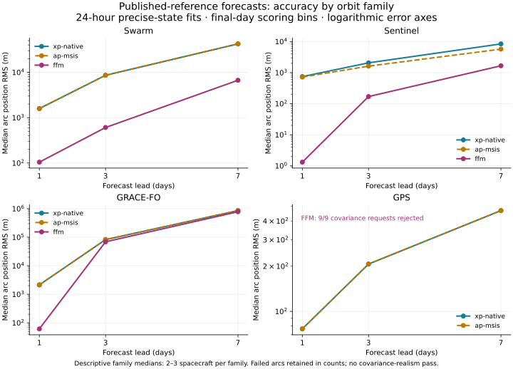

# Published-reference propagator comparison

Thirty registered arcs across ten spacecraft; module commit `cb22348f2c674e8920716af09f7ca2a6a87f5f28`. Precise orbit products are held out from each fit, not globally unseen. Accuracy gains are retained regardless of execution cost.

FFM/XP-native median paired trajectory-error ratios at 1/3/7 days are **0.038 / 0.123 / 0.253**, on 21 successful common arcs. Lower is better. Read these alongside the failures and covariance evidence: a smaller trajectory error alone does not establish trustworthy Pc.

NASA CARA 2D Foster Pc: **21/21 pass**, using unchanged upstream tolerances. This verifies the integral, not orbit prediction, covariance calibration or operational collision risk.

Orbit exclusions: 0. Failed arm/arc attempts: 9. SDN-AP contains white-room XP at this pin: “XP-native” and “AP-MSIS” are two configurations of that module. USSF WASM is excluded following the independently reproduced invalid/order-dependent behavior in the [earlier study](../propagator-ca-frontier/README.md).

## Trajectory accuracy



Median final-day position RMS in metres, across arcs. Each cell uses that arm’s successful arcs; paired comparisons below use identical support. P90, R/T/N components, exact-lead errors and all counts are in [summary.json](summary.json).

| Family | Lead | XP-native | AP-MSIS | FFM | Successful arcs XP/AP/FFM |
|---|---:|---:|---:|---:|---|
| Swarm | 1 d | 1,591.6 | 1,577.2 | 104.6 | 9/9/9 |
| Swarm | 3 d | 8,602.2 | 8,602.2 | 608.1 | 9/9/9 |
| Swarm | 7 d | 42,356.6 | 42,356.6 | 6,686.6 | 9/9/9 |
| Sentinel | 1 d | 746 | 720.7 | 1.3 | 6/6/6 |
| Sentinel | 3 d | 2,067.5 | 1,615.7 | 169.8 | 6/6/6 |
| Sentinel | 7 d | 8,420.1 | 5,708.6 | 1,663.2 | 6/6/6 |
| GRACE-FO | 1 d | 2,137.6 | 2,137.6 | 61.3 | 6/6/6 |
| GRACE-FO | 3 d | 82,567.5 | 82,567.5 | 69,064.5 | 6/6/6 |
| GRACE-FO | 7 d | 857,161.4 | 857,161.4 | 784,577.6 | 6/6/6 |
| GPS | 1 d | 76.5 | 76.5 | — | 9/9/0 |
| GPS | 3 d | 206.8 | 206.8 | — | 9/9/0 |
| GPS | 7 d | 469 | 469 | — | 9/9/0 |

## Matched comparisons

Pooled median per-arc RMS ratios, with object-cluster bootstrap intervals. A ratio below one favors the numerator. These exploratory pooled results do not establish superiority in every orbit family. Each family has fewer than five objects and is descriptive only. Failure rates remain part of the result.

| Comparison | Lead | Common arcs | Ratio | 95% interval | Decision |
|---|---:|---:|---:|---|---|
| ap-msis/xp-native | 1 d | 30 | 1.000 | 0.985–1.000 | UNRESOLVED |
| ffm/xp-native | 1 d | 21 | 0.038 | 0.021–0.064 | LOWER_ERROR_ON_COMMON_SUPPORT |
| ffm/ap-msis | 1 d | 21 | 0.038 | 0.022–0.065 | LOWER_ERROR_ON_COMMON_SUPPORT |
| ap-msis/xp-native | 3 d | 30 | 1.000 | 0.941–1.000 | UNRESOLVED |
| ffm/xp-native | 3 d | 21 | 0.123 | 0.052–0.373 | LOWER_ERROR_ON_COMMON_SUPPORT |
| ffm/ap-msis | 3 d | 21 | 0.139 | 0.057–0.424 | LOWER_ERROR_ON_COMMON_SUPPORT |
| ap-msis/xp-native | 7 d | 30 | 1.000 | 0.919–1.000 | UNRESOLVED |
| ffm/xp-native | 7 d | 21 | 0.253 | 0.130–0.770 | LOWER_ERROR_ON_COMMON_SUPPORT |
| ffm/ap-msis | 7 d | 21 | 0.322 | 0.128–0.770 | LOWER_ERROR_ON_COMMON_SUPPORT |

## Covariance coverage

One exact-lead observation per arc; no dense-sample independence claim. Primary values add available reference covariance. Realism requires both mean D²/3 in [0.8, 1.25] and 95% coverage in [93%, 97%], with at least 30 arcs and five objects. “INSUFFICIENT” is not a pass. Three arcs per object remain correlated; this is a screening diagnostic, not certification.

| Arm | Lead | Arcs | Mean D²/3 | Coverage | Prediction-only coverage | Result |
|---|---:|---:|---:|---:|---:|---|
| xp-native | 1 d | 30 | 277.5 | 63.3% | 63.3% | FAIL |
| ap-msis | 1 d | 30 | 279.4 | 63.3% | 63.3% | FAIL |
| ffm | 1 d | 21 | 12,777,982.1 | 0% | 0% | INSUFFICIENT |
| xp-native | 3 d | 30 | 876.3 | 53.3% | 53.3% | FAIL |
| ap-msis | 3 d | 30 | 880.3 | 53.3% | 53.3% | FAIL |
| ffm | 3 d | 21 | 15,701,687.9 | 0% | 0% | INSUFFICIENT |
| xp-native | 7 d | 30 | 26,272.6 | 46.7% | 46.7% | FAIL |
| ap-msis | 7 d | 30 | 26,295.2 | 46.7% | 46.7% | FAIL |
| ffm | 7 d | 21 | 269,611,549.2 | 0% | 0% | INSUFFICIENT |

## Execution cost

Median seconds on 21 arcs for which all three arms completed the same scored workload, including covariance. One sequential pass on a shared host; these are observed costs, not a controlled throughput ranking. CPU seconds include all process threads. Start/end load averages: 3.771484375, 3.16357421875, 3.26708984375 / 3.42333984375, 3.263671875, 3.26171875; 28 logical CPUs. Endpoint load measurements do not certify absence of saturation throughout the run.

| Arm | Fit wall | Forecast wall | Score wall | Total wall | Total CPU |
|---|---:|---:|---:|---:|---:|
| xp-native | 0.0291 | 0.0162 | 0.0033 | 0.0486 | 0.0514 |
| ap-msis | 0.0860 | 0.0693 | 0.0030 | 0.1596 | 0.1611 |
| ffm | 5.8197 | 10.3455 | 0.0035 | 16.2373 | 16.5830 |

## Engineering decisions

Preserve FFM’s full force model: the matched LEO accuracy gains are valuable regardless of their execution cost. The measured atmosphere substitution does not establish a pooled improvement across every family; retain the separate atmosphere/prior study rather than infer that more accurate physics has no value.

The immediate blockers are FFM’s GPS covariance rejection and forecast-uncertainty realism. Reproduce the GPS rejection at the FFM covariance-input boundary before changing the estimator or numerical conditioning. Train forecast uncertainty on separate arcs and validate it on a newly frozen holdout, including encounter-plane errors and Pc sensitivity. Audit the large GRACE-FO long-lead errors against maneuver and product-quality information before attributing them to a force model.

Optimize execution around accuracy-preserving changes, including the earlier bit-exact batching result. These measurements do not justify cutting forces, dropping difficult cases or accepting nominal 95% uncertainty with poor observed coverage.

## Failures and limits

- 26407-2026-09-03, ffm: Error: propagator/ffm invoke: invalid-covariance: invalid-covariance: Singular covariance has an inconsistent cross term..
- 26407-2026-09-08, ffm: Error: propagator/ffm invoke: invalid-covariance: invalid-covariance: Singular covariance has an inconsistent cross term..
- 26407-2026-09-13, ffm: Error: propagator/ffm invoke: invalid-covariance: invalid-covariance: Singular covariance has an inconsistent cross term..
- 27663-2026-09-03, ffm: Error: propagator/ffm invoke: invalid-covariance: invalid-covariance: Singular covariance has an inconsistent cross term..
- 27663-2026-09-08, ffm: Error: propagator/ffm invoke: invalid-covariance: invalid-covariance: Singular covariance has an inconsistent cross term..
- 27663-2026-09-13, ffm: Error: propagator/ffm invoke: invalid-covariance: invalid-covariance: Singular covariance has an inconsistent cross term..
- 28190-2026-09-03, ffm: Error: propagator/ffm invoke: invalid-covariance: invalid-covariance: Singular covariance has an inconsistent cross term..
- 28190-2026-09-08, ffm: Error: propagator/ffm invoke: invalid-covariance: invalid-covariance: Singular covariance has an inconsistent cross term..
- 28190-2026-09-13, ffm: Error: propagator/ffm invoke: invalid-covariance: invalid-covariance: Singular covariance has an inconsistent cross term..

The 24-hour fits use retrospective precise states, not public TLEs. The estimators differ, so force models alone cannot explain all differences. Final EOP and historical revised weather are not a verified as-issued forecast replay. Driver dates stop before issue day and then persist. Maneuvers were not independently screened; no residual-based exclusions were made.

Swarm uses ESA/TU Delft reduced-dynamic products. Sentinel uncertainties encode the product accuracy requirement rather than measured epoch-specific errors. GRACE-FO uses GFZ rapid RSO, not final GNV1B; overlap uncertainties are not independent absolute accuracy. GPS uses ESA final SP3. Source URLs, checksums and converter metadata are retained in the provenance file. The existing truth gate applies to every reference product.

No force model was trimmed or tuned against these scores. DCA/prior merit remains in the separately owned XM study. The scope does not test conjunction screening, TCA search, 3D Pc, Monte Carlo Pc or calibration against physical collisions.

## Reproduce

The original [frozen plan](../../experiments/propagator-published-truth/PLAN.md) and [configuration](../../experiments/propagator-published-truth/config.json) preceded state access. Integration corrected the weather record constructor, UTC parsing and explicit SI scorer inputs. A dated appended amendment adds a pinned time-module check of FFM’s TDB output labels against the requested UTC grid, within 1 ms; no state shifting or interpolation is performed. All arcs were rerun with these corrections. Scientific scoring, selection and physics were unchanged.

```sh
node experiments/propagator-published-truth/run.mjs --modules "$SDN_MODULES_ROOT" --run registered
node experiments/propagator-published-truth/pc.mjs --modules "$SDN_MODULES_ROOT" --run pc-registered
node experiments/propagator-published-truth/report.mjs --run registered
node experiments/propagator-published-truth/verify.mjs --modules "$SDN_MODULES_ROOT"
```

Run names must be fresh. The real local archive and pinned module checkout are required; missing data is a visible skip, never a pass. The E2E checks provenance, replays the first registered arc of each family and all 21 Pc cases, and regenerates aggregates/report exactly. The report renders the chart with `uv` and locked Matplotlib dependencies. Raw ephemerides and per-epoch tables are not committed.

Sources: [ESA/TU Delft Swarm product catalogue](https://swarm-disc.github.io/product-catalogue-tools/SW_SP3xCOM_2_.html), [Copernicus POD](https://sentiwiki.copernicus.eu/web/precise-orbit-determination), [GFZ GRACE-FO](https://isdc-data.gfz.de/grace-fo/), [NASA CARA software](https://www.nasa.gov/cara/publicly-available-cara-software/).
